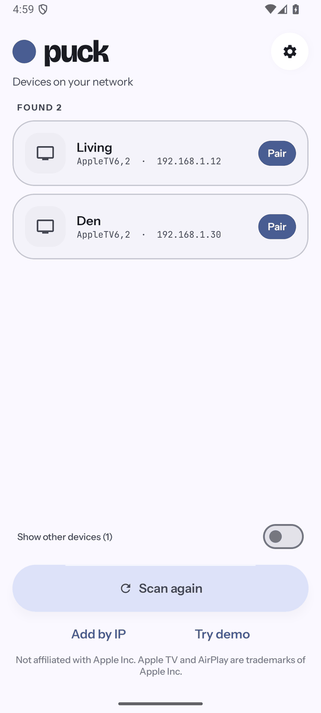
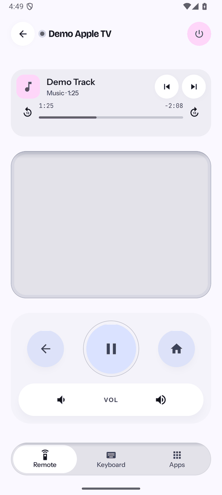
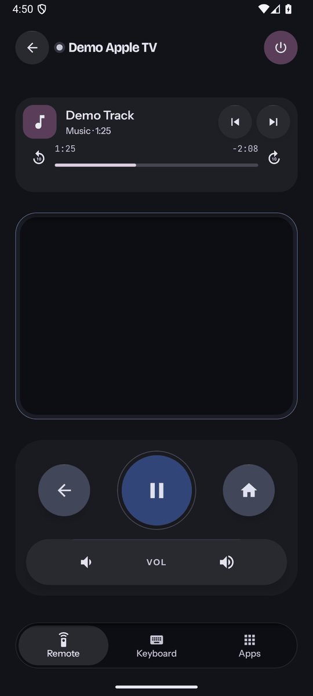
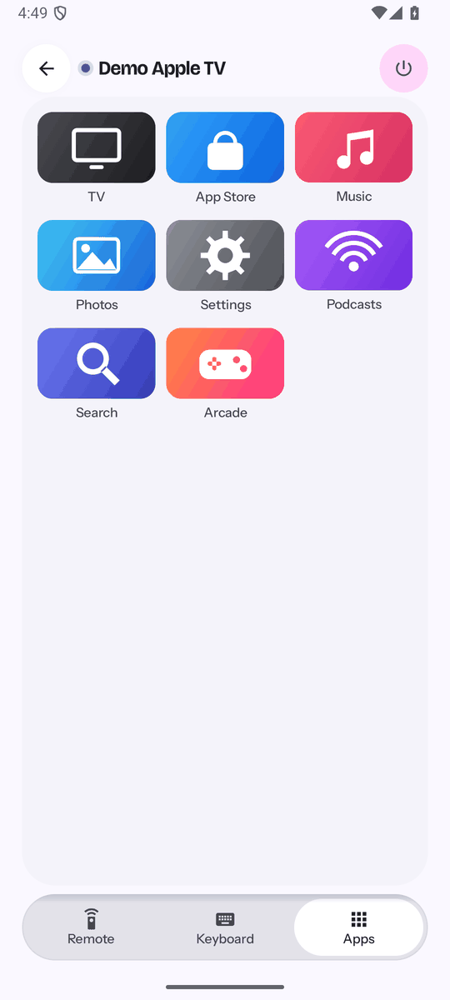
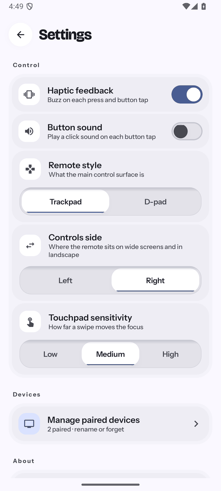
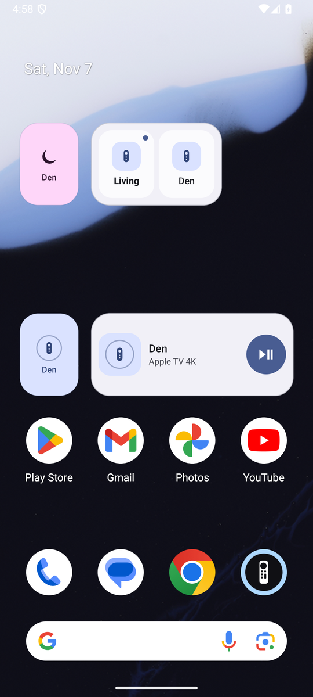

<div align="center">


# Puck

**A native Android remote for Apple TV — built to control more than one.**

[](https://github.com/iamclements/puck/actions/workflows/ci.yml)
[](https://github.com/iamclements/puck/actions/workflows/codeql.yml)
[](https://github.com/iamclements/puck/releases/latest)
[](LICENSE)

</div>

Puck speaks Apple's Companion Link protocol natively in Kotlin — no companion
server, no Python bridge, nothing else to run. Just an APK on your phone,
talking straight to your Apple TV over the LAN.

> **Not affiliated with Apple Inc.** "Apple", "Apple TV", "AirPlay" and "Siri"
> are trademarks of Apple Inc., registered in the U.S. and other countries,
> used here solely to describe compatibility.

<p align="center">
  
  
  
</p>
<p align="center">
  
  
  
</p>
<p align="center"><sub>Screenshots are from an Android emulator: the built-in demo mode for the remote, apps and settings, and placeholder TVs behind the widgets. No Apple TV is being controlled.</sub></p>

## Features

- **Multiple Apple TVs, properly paired.** Discovery finds every Apple TV on
  your network, and Puck keeps more than one paired at a time — switch between
  them from one list instead of re-pairing every time you change rooms.
- **A trackpad that works like the real remote.** Tap an edge for one step,
  hold to repeat, press the middle to select, or swipe anywhere to pan and
  momentum-scroll. Prefer buttons? Switch to a classic D-pad in Settings.
- **Back, Home, Play/Pause, Power and volume** — the play button
  reflects real playback state; power taps open Control Centre and holds wake
  a sleeping Apple TV, same as the hardware remote.
- **Only your Apple TVs in the list.** Macs and other devices that speak the
  same protocol are hidden unless you ask for them with a switch on the scan
  screen.
- **Add by IP address** for networks where discovery cannot see the Apple TV
  (guest Wi-Fi, mesh, another subnet), and a **demo mode** to look around
  with no Apple TV at all.
- **App drawer** with real tvOS app icons, fetched from the App Store.
- **Text entry** straight from your phone's keyboard, including a lock-screen
  reply field when the TV asks for text while your phone is locked.
- **Now playing** — artwork, a draggable scrubber, skips and volume, backed by
  a full media notification and lock-screen controls.
- **Home-screen widgets, Quick Settings tiles, and launcher shortcuts** — jump
  straight into a specific Apple TV without opening the app first.
  - *Room* widget: one TV, from a single tile up to a panel with Play/Pause,
    Sleep and volume.
  - *Rooms* widget: all your TVs as keys, the one you used last first. Offered
    once you have two.
  - *Action button* widget: Play/Pause, Wake or Sleep in one tap.
  - One **Quick Settings tile per saved TV**: one TV shows one tile, three
    show three.

  Specs in [`docs/WIDGET_SPEC.md`](docs/WIDGET_SPEC.md).
- **Material You** dynamic colour on Android 12+, light and dark themes, and
  layouts for tablets and foldables.

See [`docs/ARCHITECTURE.md`](docs/ARCHITECTURE.md) for how the protocol layer
and Android app are put together — Companion Link pairing, the AirPlay/MRP
now-playing tunnel, and the module layout.

## Download

| Source | Status |
|---|---|
| [GitHub Releases](../../releases/latest) | ✅ Signed APK, available now |
| Google Play | 🚧 Coming soon |
| F-Droid | 🚧 Submission pending a tagged release — recipe ready at [`docs/fdroid/`](docs/fdroid/) |

Requires **Android 8.0 (API 26)** or newer, on the same Wi-Fi network as the
Apple TV. Installing the GitHub release needs "allow installation from unknown
sources" since it isn't yet on a store.

Builds named `dev-N` on the [Releases page](../../releases) are pre-release
test builds of the `dev` branch, cut on demand. They install as a separate app,
**Puck Dev**, next to the real one, and are not meant for everyday use.

## Pairing

1. Open the app and tap your Apple TV.
2. Enter the 4-digit code shown on the TV. **The code expires quickly** — if
   pairing stalls, cancel and try again for a fresh code.
3. Optionally tap **Show what's playing** to enable now-playing, which needs a
   second, independent pairing with its own code.

Credentials are encrypted with a key held in the Android Keystore. They grant
full control of the Apple TV, so treat them like a password.

## Compatibility

Verified end-to-end against an **Apple TV 4K (AppleTV14,1) running tvOS 26.6**.
The Companion Link protocol has been stable since tvOS 13, so other models and
versions from that era onward are expected to work, but are untested — please
open an issue either way, reports of what works are as useful as bug reports.

Apple TV 3rd generation and earlier are **not** supported; they use the older
DMAP protocol, which modern devices have dropped entirely.

Volume controls appear only when the Apple TV reports it can route volume. A
Siri Remote that changes volume over infrared never puts the Apple TV in the
path, so no network client — Puck included — can control it there; volume is
expected to work on HDMI-CEC setups instead.

## Security

See [PRIVACY.md](PRIVACY.md) for the plain-language version of what leaves
your device and what doesn't.

- Pairing credentials are encrypted with an AES-GCM key held in the Android
  Keystore, non-extractable on most devices. Backups are disabled, since
  Keystore-wrapped ciphertext cannot be restored onto other hardware.
- No analytics, no account. The app requests only the network and
  notification permissions the remote and media controls need.
- **One request leaves your network:** the app drawer looks up each app's icon
  against Apple's public iTunes endpoint, so Apple learns which apps are
  installed on your TV. Everything else — the remote itself, pairing,
  now-playing — works entirely on the LAN.

**How the code is checked.** [CodeQL](https://github.com/iamclements/puck/actions/workflows/codeql.yml)
analyses the Kotlin code, the Python tooling and the GitHub workflows on every
push and pull request and weekly. GitHub secret scanning with push protection
is on, Dependabot proposes dependency updates (and security updates) weekly,
and the protocol layer's crypto is tested byte-for-byte against pyatv reference
vectors. Results are under the repository's Security tab.

**Found a security issue?** Please report it privately through
[GitHub's private vulnerability reporting](https://github.com/iamclements/puck/security/advisories/new)
rather than a public issue.

## Building

Requires **JDK 21** (Android Gradle Plugin does not support JDK 25) and the
Android SDK with platform 36.

```bash
./gradlew :app:assembleDebug      # installable debug APK
./gradlew :app:assembleDev        # minified, installs beside the real app as "Puck Dev"
./gradlew :app:assembleRelease    # minified, ~3 MB; signed only if keystore.properties exists
./gradlew :protocol:test          # conformance tests
./gradlew :app:testDebugUnitTest  # app unit tests
./gradlew :app:lintDebug          # Android Lint
```

The release and dev builds are signed with the key in `keystore.properties`
(gitignored) when it exists; without it a release build is left unsigned and a
dev build falls back to the debug key, so a fresh clone builds either way.

A `cli/` module exists for exercising the protocol from a terminal without a
phone — see [`docs/ARCHITECTURE.md`](docs/ARCHITECTURE.md#correctness) for
details.

## Contributing

Contributions are welcome — especially **compatibility reports** for models
and tvOS versions other than the one tested.

Please run `./gradlew :protocol:test :app:testDebugUnitTest` before opening a
pull request. If you
change protocol behaviour, add a conformance vector rather than only a
round-trip test: self-consistency proves nothing about what a real device
accepts.

Commits follow [Conventional Commits](https://www.conventionalcommits.org/en/v1.0.0/)
(`feat: ...`, `fix: ...`, `docs: ...`, and so on) — CI checks this on every
pull request. Lint and CodeQL also run on every pull request; `./gradlew
:app:lintDebug` is worth a local run before pushing.

There are two long-lived branches: **`dev`** is where work lands and is tested
(a *Puck Dev* pre-release is cut from it on demand), and **`main`** is
production, only ever updated from `dev` and tagged for release. **Open pull
requests against `dev`.** The full flow, including how a dev build and a
release are cut, is in [docs/RELEASING.md](docs/RELEASING.md).

## Credits

Puck is a fork of [**Remote for Apple
TV**](https://github.com/msthind04/AppleTV-Remote) by
[msthind04](https://github.com/msthind04) — the original protocol work
(Companion Link, AirPlay/MRP, the SRP6a/HAP pairing handshake, OPACK and
binary-plist codecs) and remote-control UI come from that project. This fork
renames the app, adds persistent multi-device support with home-screen
quick-action shortcuts, widgets and Quick Settings tiles, and carries its own
visual design going forward. See `git log` for the full history of what
changed after the fork point.

Protocol knowledge and test vectors are derived from
[pyatv](https://github.com/postlund/pyatv) (MIT). See
[THIRD_PARTY_NOTICES.md](THIRD_PARTY_NOTICES.md).

## Licence

Licensed under the [Apache License 2.0](LICENSE), like the original — see
[NOTICE](NOTICE).

Companion Link is an undocumented Apple protocol; this is a clean-room-style
implementation built from public reverse-engineering work. It controls
hardware you own, on your own network.
